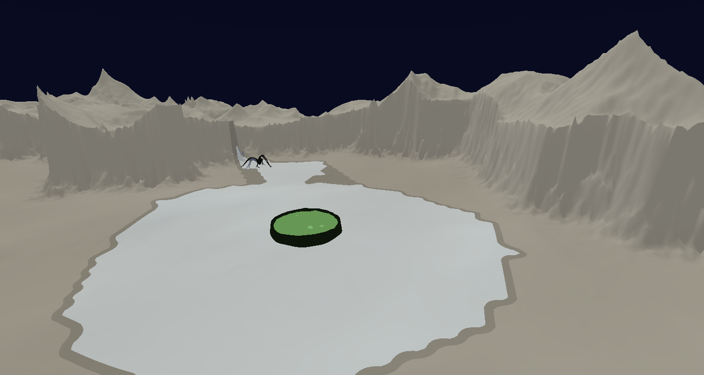
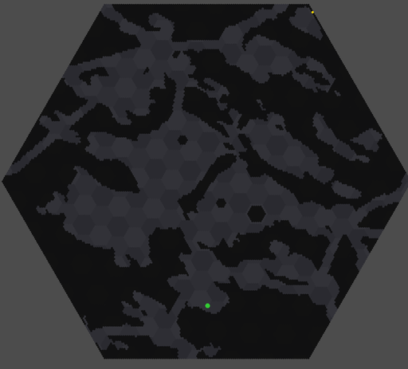
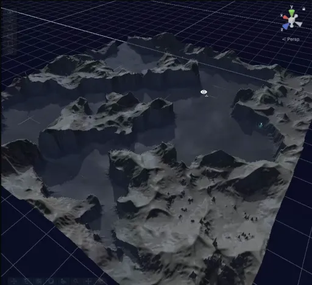
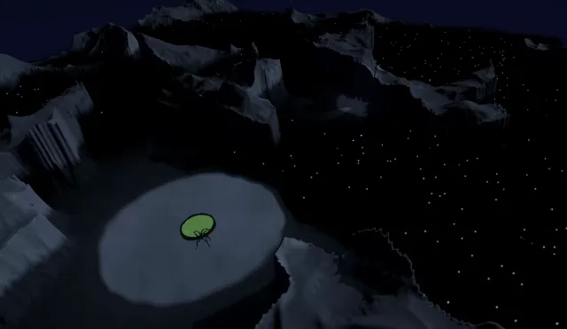

# Autonomy — a programmable bot game: players write the bots, and the bots play

Players write code for their bots, upload it, and the bots play on their own in one shared world. My
server runs every player's bot once a second, each sealed in its own sandbox, so a broken or hostile
bot can't hurt the game. The server lists 24 programming languages; Python runs end to end today, and
the game offers only the languages that run.

Designed and built solo since November 2025 by Andreas Sjögren. I make every design decision and review every change; AI coding agents write code under checks I set up.

Backend .NET engineer. A write-up of my ongoing passion project, which I intend to finish; no buildable source ([why](#why-there-is-no-source-here)).

*The Unity client, June 2026: an earlier client, archived in October 2026.*

## What I built

- **A server that runs everyone's code, every second.** Each bot gets 150 ms of CPU per tick and is
  cut off past its limit; it loses its turn, never the game.
- **Fast enough for a crowd.** Each bot answers in 1–5 ms, down from 50–100 ms.
- **No peeking through the fog of war.** Hidden enemy units are never sent to a player.
- **One client, in Godot.** It only draws what the server sends. There is no browser view yet: Godot
  cannot export C# to the web.
- **Four clients built, one kept.** Godot, Unity 2D, Unreal and Unity 3D came first; since October
  2026 Godot is the only client and the others are archived. The pictures here are from those earlier
  clients.

<table><tr>
<td width="33%"> Nov 2025 — the first Godot client, 2D hexagons</td>
<td width="33%"> May 2026 — Unity 3D terrain, an earlier client</td>
<td width="33%"> Jun 2026 — a colony's clearing, Unity, an earlier client</td>
</tr></table>

## By the numbers

| | |
|---|---|
| Languages the server lists | 24, with Python running end to end |
| Automated tests | 1,850 passing (CI run of 2026-09-20) |
| Server code | ~80,000 lines of C# (2026-09-20) |
| Dated specs | over 200 |
| Built | solo, since November 2025 |

## Explore

- **[The game and its world](docs/the-game-and-its-world.md)** — how it looks, and how it got that
  look.
- **[Running strangers' code safely](docs/running-strangers-code-safely.md)** — untrusted bots every
  second, without breaking the game or seeing too much.
- **[What happens every second](docs/what-happens-every-second.md)** — the loop that turns every bot's
  orders into one fair result.
- [Player API reference](https://edes0.github.io/programmable-bot-game/player-api/) (live)

## Stack

.NET 10 · ASP.NET Core · EF Core · MediatR · Docker · WebSockets / SignalR · xUnit ·
BenchmarkDotNet · Godot 4.7 (C#) · GitHub Actions

## Why there is no source here

Keeping the source private is a decision, not an omission. The engine is a game I intend to keep
building and eventually run, and publishing it would mean publishing a working server that anyone
could stand up as their own. So this repository carries the parts that survive being read rather than
executed: architecture, protocols, decisions, measurements, and short excerpts of the real code —
quoted with the path they came from, so you can see what the code actually looks like without
receiving a copy of it.

Names in the code excerpts are changed from the private repository; the code is otherwise as written.

If you are evaluating me and want to read more of it, ask — [sjogrenandreas@live.se](mailto:sjogrenandreas@live.se).

## Licence

Prose, diagrams and images: CC BY-NC-ND 4.0. Code excerpts: all rights reserved, reproduced here
for illustration only. See [LICENSE.md](LICENSE.md).

---

**Andreas Sjögren** — [sjogrenandreas@live.se](mailto:sjogrenandreas@live.se) · [github.com/Edes0](https://github.com/Edes0)
